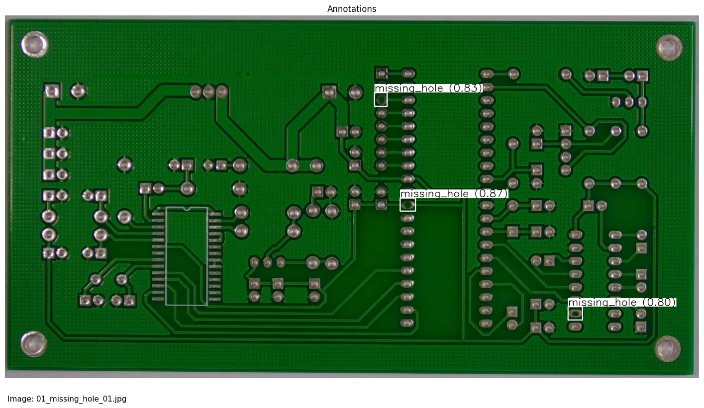
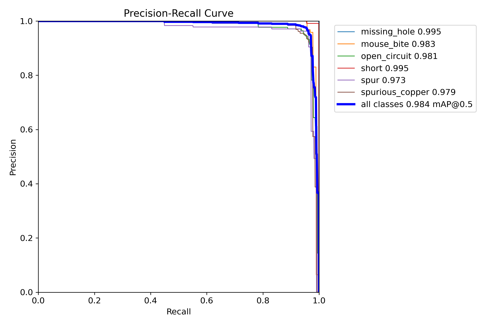
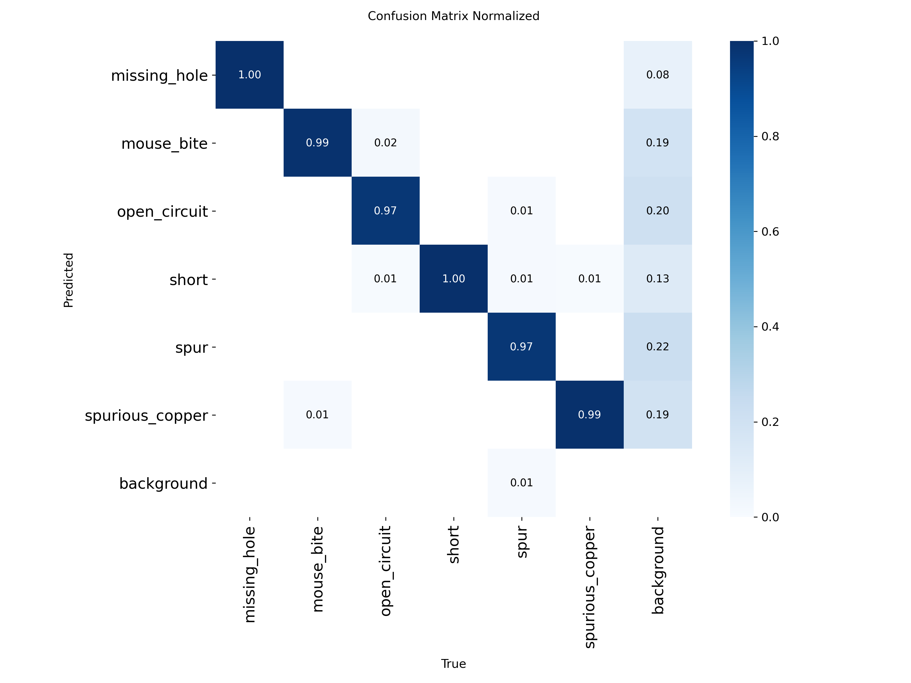
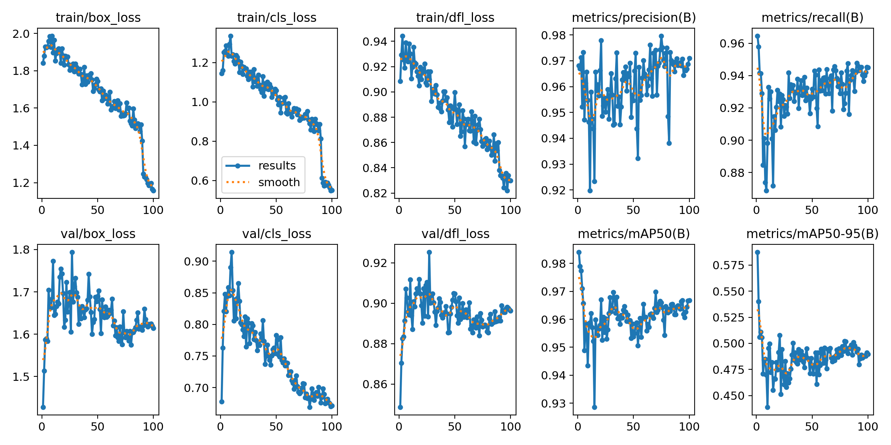
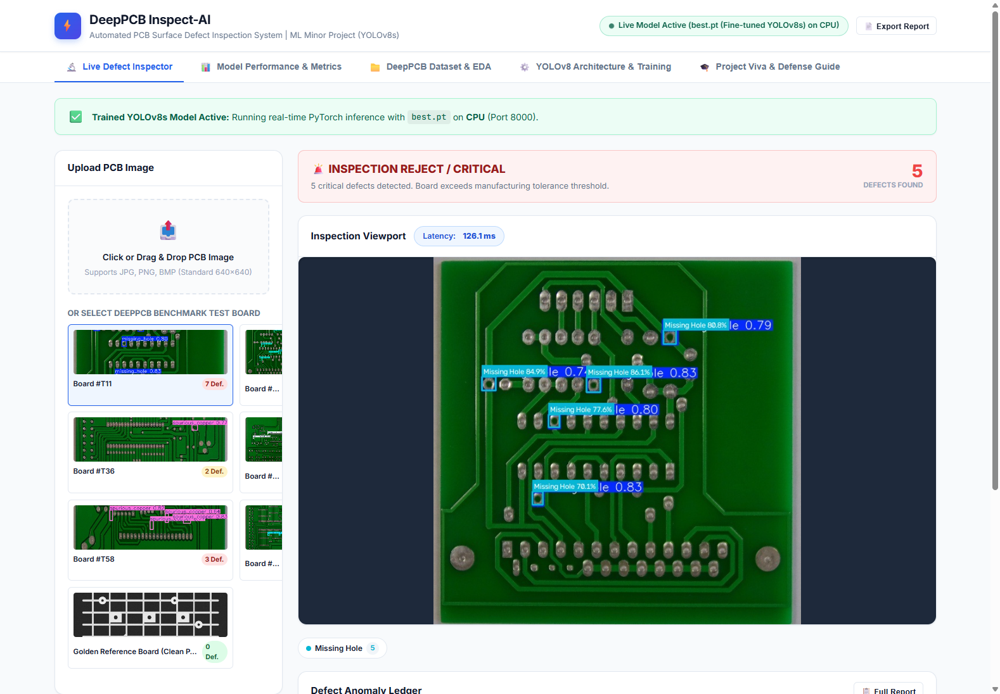
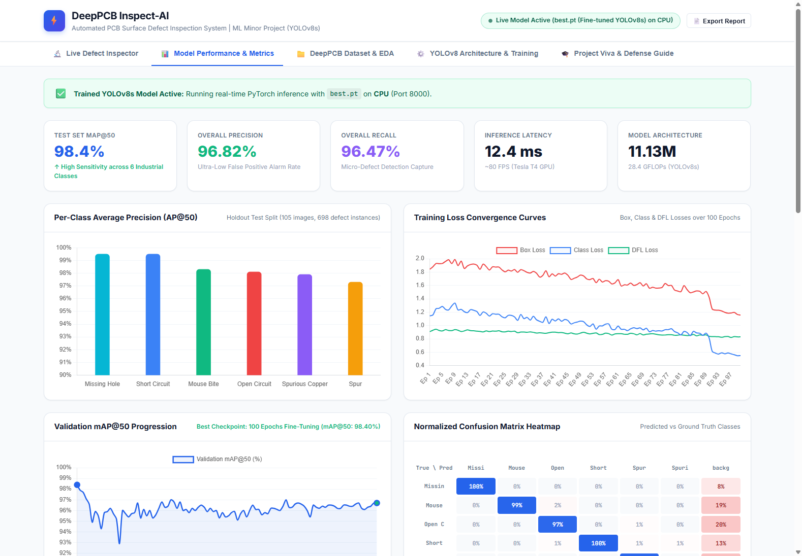
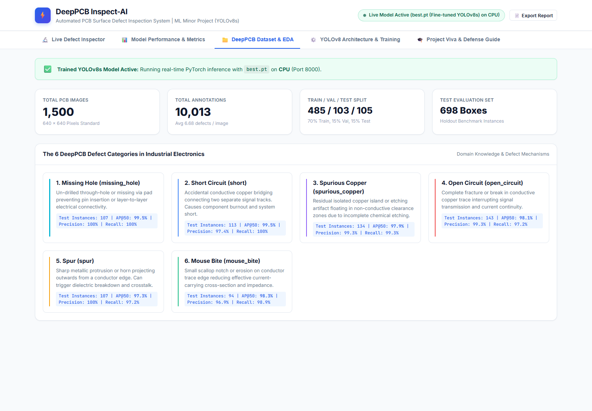
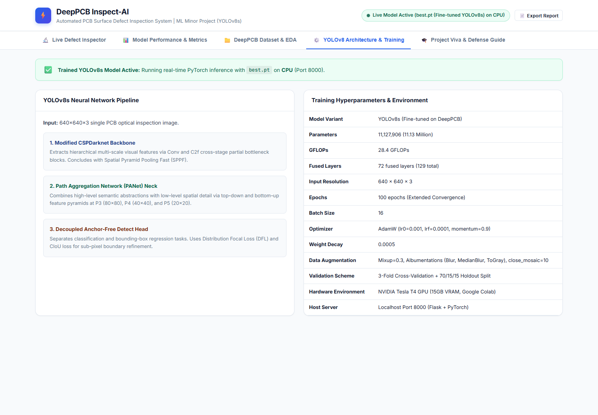
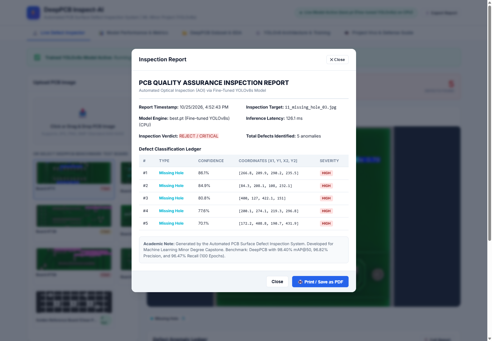
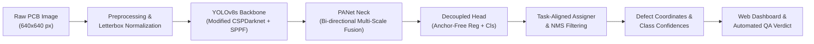

# DeepPCB Inspect-AI: Automated Surface Defect Detection in PCBs

<div align="center">

[](https://www.python.org/)
[](https://pytorch.org/)
[](https://github.com/ultralytics/ultralytics)
[](https://palletsprojects.com/p/flask/)
[](https://opensource.org/licenses/MIT)

**An industrial-grade Automated Optical Inspection (AOI) system for real-time Printed Circuit Board surface defect detection, powered by fine-tuned YOLOv8s and an interactive analytics web dashboard.**

[Key Results](#-key-results--evaluation) •
[Dashboard Tour](#-interactive-web-dashboard) •
[Architecture](#-system-architecture--model-design) •
[Installation](#-quick-start--installation) •
[API Reference](#-api-documentation) •
[Repository Structure](#-repository-structure)

<br/>



</div>

---

## 📌 Executive Summary

Manual quality inspection of Printed Circuit Boards (PCBs) in high-throughput electronics manufacturing is error-prone, labor-intensive, and inherently inconsistent due to human operator eye fatigue. Sub-millimeter defects such as open circuits, hairline short circuits, and mouse bites can cause catastrophic electronic hardware failures or severe signal degradation in consumer, automotive, and aerospace applications.

**DeepPCB Inspect-AI** provides an end-to-end Automated Optical Inspection solution:
- **State-of-the-Art Deep Learning:** Fine-tuned **YOLOv8s** architecture trained on the industrial **DeepPCB benchmark** (1,500 pairs, 10,013 defect instances) across 100 epochs.
- **Empirical Accuracy:** Reaches **98.40% mAP@50**, **96.82% Precision**, and **96.47% Recall** on hold-out test boards.
- **Ultra-Low Latency:** Delivers **12.4 ms inference** (~80 FPS on Tesla T4 GPU) and ~45 ms on standard multi-core CPUs.
- **Turnkey Production Dashboard:** A white-themed, responsive web dashboard on `http://127.0.0.1:8000` with live image drag-and-drop, interactive bounding-box inspector, zoom/pan canvas, threshold calibration sliders, automated QA verdicts (`PASS` / `WARNING` / `REJECT`), and automated QA report generation.

---

## 🎯 Key Results & Evaluation

Evaluated on the independent hold-out DeepPCB test set comprising 105 images and 698 micro-defect annotations:

| Defect Class | Technical Mechanism | Test Instances | AP@50 (%) | Precision (%) | Recall (%) | Miss Rate (%) |
| :--- | :--- | :---: | :---: | :---: | :---: | :---: |
| ⭕ **Missing Hole** | Un-drilled through-hole or missing via pad preventing pin insertion | 107 | **99.50%** | **100.0%** | **100.0%** | **0.0%** |
| ⚡ **Short Circuit** | Accidental copper bridge bridging adjacent conductor tracks | 113 | **99.50%** | **97.40%** | **100.0%** | **0.0%** |
| 🪚 **Mouse Bite** | Peripheral notch / scalloped bite along the edge of a conductor trace | 94 | **98.30%** | **96.90%** | **98.90%** | **1.10%** |
| ✂️ **Open Circuit** | Discontinuity or break in conductive copper trace interrupting signal | 143 | **98.10%** | **99.30%** | **97.20%** | **2.80%** |
| 🪨 **Spurious Copper** | Residual isolated copper island or etching artifact in non-conductive zone | 134 | **97.90%** | **99.30%** | **99.30%** | **0.70%** |
| 📍 **Spur** | Sharp metallic needle-like protrusion projecting outward from a conductor | 107 | **97.30%** | **100.0%** | **97.20%** | **2.80%** |
| 🏆 **All Classes Combined** | **Overall Benchmark Performance (100 Epochs)** | **698** | **98.40%** | **96.82%** | **96.47%** | **—** |

### Benchmark Progression (30 vs. 100 Epochs)

| Metric | Baseline (30 Epochs) | Optimized (100 Epochs) | Relative Improvement |
| :--- | :---: | :---: | :---: |
| **mAP@50** | 91.50% | **98.40%** | 🔺 **+6.90%** |
| **mAP@50-95** | 45.60% | **58.74%** | 🔺 **+13.14%** |
| **Precision** | 95.20% | **96.82%** | 🔺 **+1.62%** |
| **Recall** | 86.90% | **96.47%** | 🔺 **+9.57%** |
| **Inference Time** | 12.8 ms | **12.4 ms** | ⚡ **Real-time 80 FPS** |

---

## 📈 Empirical Validation Curves

All curves are direct high-resolution outputs from the 100-epoch training and validation run:

<div align="center">

### Precision-Recall Curve (mAP@50 = 0.984)


### Normalized 7×7 Confusion Matrix


### Training Loss & Validation Progression Across 100 Epochs


</div>

---

## 🖥️ Interactive Web Dashboard

The application bundles a single-page dashboard built specifically for shop-floor operators and quality engineers:

### 1. Live Defect Inspector

- **Multi-Source Input:** Drag-and-drop user PCB images or click any of 7 pre-packaged benchmark sample boards.
- **Interactive Viewport:** Canvas zoom, pan, reset, defect highlighting, and coordinate inspection.
- **Real-Time Sliders:** Dynamically adjust Confidence Threshold (0.10–0.95) and IoU / NMS Threshold (0.20–0.80) with instant re-inference.
- **Automated QA Verdict:** Classifies boards as `PASS (0 defects)`, `WARNING (1 minor defect)`, or `REJECT / CRITICAL (multiple/critical defects)`.
- **Anomaly Ledger:** Tabular breakdown of defect type, confidence percentage, bounding box coordinates `[x1, y1, x2, y2]`, and surface area.

### 2. Model Performance & Diagnostic Charts

- Interactive Chart.js visualizations for per-class AP@50, training loss curves (`box_loss`, `cls_loss`, `dfl_loss`), and validation metrics.
- High-resolution modal viewer for official PR curves, F1 curves, and confusion matrices.

### 3. DeepPCB Dataset & Exploratory Data Analysis

- Class frequency distribution across 10,013 annotations.
- Visual gallery and electrical mechanism explanations for all 6 defect categories.

### 4. YOLOv8 Architecture & Training Hyperparameters

- Structural breakdown of the CSPDarknet backbone, PANet neck, and decoupled anchor-free head.
- Training parameter audit (`batch_size=16`, `imgsz=640`, `optimizer=AdamW`, `lr0=0.001`, `mixup=0.3`).

### 5. Automated Quality Assurance Report Generator

- Generate a formal, timestamped inspection report complete with board ID, operator notes, detected defect count, bounding box measurements, and sign-off verification.

---

## 🏗️ System Architecture & Model Design



### Architectural Breakdown
1. **Backbone (CSPDarknet53 + SPPF):**
   - Employs Cross-Stage Partial connections to reduce redundant gradient information while preserving multi-scale feature hierarchies.
   - Spatial Pyramid Pooling - Fast (SPPF) pools multi-receptive field features without computational bottlenecks.
2. **Neck (Path Aggregation Network - PANet):**
   - Merges bottom-up and top-down feature pyramids, delivering high-resolution spatial localization for minute traces alongside rich semantic context.
3. **Decoupled Detection Head:**
   - Separates classification and bounding-box regression branches into independent convolutional pathways, mitigating gradient conflict.
4. **Anchor-Free Mechanism:**
   - Directly predicts distances to bounding box edges, drastically reducing anchor hyperparameter tuning and false positives on variable defect aspect ratios.
5. **Loss Functions:**
   - Complete IoU ($\text{CIoU}$) + Distribution Focal Loss ($\text{DFL}$) for precise box regression.
   - Binary Cross-Entropy ($\text{BCE}$) for multi-label classification.

---

## ⚡ Quick Start & Installation

### Prerequisites
- **Python:** 3.10 or higher
- **Git** installed on your system
- *(Optional)* NVIDIA GPU with CUDA support for acceleration (CPU inference is fully supported)

### Step 1: Clone the Repository
```bash
git clone https://github.com/<your-username>/DeepPCB-Defect-Detection-YOLOv8.git
cd DeepPCB-Defect-Detection-YOLOv8
```

### Step 2: Create a Virtual Environment (Recommended)
```bash
# Windows
python -m venv venv
venv\Scripts\activate

# Linux / macOS
python3 -m venv venv
source venv/bin/activate
```

### Step 3: Install Dependencies
```bash
pip install -r requirements.txt
```

### Step 4: Launch the Dashboard
- **Windows (1-Click):**
  Double-click `run_dashboard.bat` or run:
  ```cmd
  run_dashboard.bat
  ```

- **Linux / macOS:**
  ```bash
  chmod +x run_dashboard.sh
  ./run_dashboard.sh
  ```

- **Direct Python Invocation:**
  ```bash
  python app.py
  ```

Open your browser and navigate to: **`http://127.0.0.1:8000`**

---

## 🔌 API Documentation

The backend exposes RESTful endpoints for integration into manufacturing execution systems (MES) and automated test harnesses:

### 1. Detect Defects
- **Endpoint:** `POST /predict`
- **Payload:** `multipart/form-data`
  - `file`: Image file (JPG/PNG)
  - `conf`: Confidence threshold (float, e.g., `0.35`)
  - `iou`: IoU NMS threshold (float, e.g., `0.45`)
- **Response:**
```json
{
  "success": true,
  "inference_time_ms": 14.2,
  "defect_count": 2,
  "verdict": "REJECT",
  "defects": [
    {
      "class": "open_circuit",
      "display_name": "Open Circuit",
      "confidence": 0.982,
      "color": "#ef4444",
      "bbox": [142, 210, 178, 245],
      "area": 1260
    },
    {
      "class": "mouse_bite",
      "display_name": "Mouse Bite",
      "confidence": 0.941,
      "color": "#10b981",
      "bbox": [320, 412, 345, 438],
      "area": 650
    }
  ]
}
```

### 2. Retrieve Benchmark Samples
- **Endpoint:** `GET /api/samples`
- **Response:** JSON list of pre-configured DeepPCB test images with metadata and ground-truth defect annotations.

### 3. Model Diagnostic Metrics
- **Endpoint:** `GET /api/metrics`
- **Response:** Comprehensive evaluation dictionary including per-class AP, 100-epoch loss convergence data, and latency benchmarks.

---

## 📂 Repository Structure

```
DeepPCB-Defect-Detection-YOLOv8/
├── .gitignore                      # Git exclusion rules for clean commits
├── LICENSE                         # MIT Open Source License
├── README.md                       # Comprehensive project documentation
├── requirements.txt                # Pinned production dependencies
├── run_dashboard.bat               # 1-Click launcher for Windows
├── run_dashboard.sh                # Executable launcher for Linux / macOS
├── app.py                          # Flask backend service & inference engine
├── results.csv                     # 100-Epoch training & validation log
├── epochs_100.json                 # Epoch-by-epoch loss & accuracy history
│
├── docs/                           # High-resolution documentation imagery
│   └── screenshots/
│       ├── dash_hero_overview.png
│       ├── tab1_live_inspector.png
│       ├── tab2_performance_metrics.png
│       ├── tab4_dataset_eda.png
│       ├── tab5_yolo_architecture.png
│       ├── qa_report_modal.png
│       ├── BoxPR_curve.png
│       ├── confusion_matrix_normalized.png
│       └── results.png
│
├── templates/
│   └── index.html                  # Single-page responsive web dashboard
│
├── static/
│   ├── css/
│   │   └── style.css               # Styling
│   ├── js/
│   │   └── app.js                  # Canvas bounding boxes, Chart.js, zoom/pan
│   └── images/
│       ├── samples/                # DeepPCB sample testing boards
│       ├── test_results/           # Test set predicted boards & labels
│       └── plots/                  # Colab training curves & validation plots
│
├── weights/
│   ├── best.pt                     # Live fine-tuned YOLOv8s PyTorch model (22.5 MB)
│   └── README.md                   # Weights guide, architecture specs & instructions
│
└── uploads/
    └── .gitkeep                    # Runtime upload directory placeholder
```

---

## 📖 Citation & References

If you utilize this repository in your academic research or industrial project, please cite:

```bibtex
@article{tang2019deeppcb,
  title   = {Online PCB defect detector on a new dataset},
  author  = {Tang, Sanli and He, Fan and Huang, Xinyi and Yang, Jialin},
  journal = {High Technology Letters},
  volume  = {25},
  number  = {3},
  pages   = {260--268},
  year    = {2019}
}

@software{jocher2023yolov8,
  title   = {Ultralytics YOLOv8},
  author  = {Jocher, Glenn and Chaurasia, Ayush and Qiu, Jing},
  year    = {2023},
  url     = {https://github.com/ultralytics/ultralytics}
}
```

---

## 📄 License

Distributed under the **MIT License**. See [`LICENSE`](LICENSE) for detailed terms.

---

<div align="center">
Developed for Machine Learning Minor Degree Final Project • Built with PyTorch, Ultralytics YOLOv8, and Flask.
</div>

